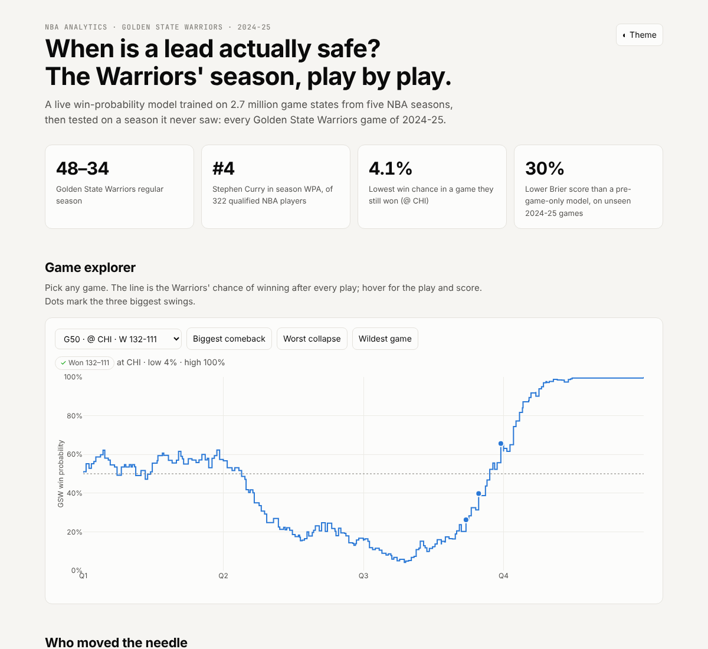

# When is a lead actually safe? NBA win probability, play by play

[](https://github.com/Addin2nd/nba-win-probability/actions/workflows/ci.yml)

An in-game win probability model for the NBA, trained on **2.7 million game states** from five seasons and tested on a season it never saw. It's then used to tell the story of the **Golden State Warriors' 2024-25 season**: which comebacks were really unlikely, which plays swung games, and who moved the needle most.

**▶ Live dashboard: https://addin2nd.github.io/nba-win-probability/**



## Results (test season 2024-25, never used for training or selection)

| Model | Log loss | Brier | AUC | Calibration error (ECE) |
|---|---:|---:|---:|---:|
| **Logistic regression (selected)** | **0.448** | **0.150** | **0.864** | **0.016** |
| Gradient boosting (monotonic) | 0.452 | 0.151 | 0.862 | 0.018 |
| Pre-game Elo only (baseline) | 0.613 | 0.213 | 0.722 | 0.047 |

* The in-game model cuts the Brier score by **30%** compared with knowing only pre-game team strength.
* The interpretable logistic model **beat gradient-boosted trees** once the features encoded the right basketball structure: a lead measured relative to the time left (`margin / √(minutes + 1)`), and a pre-game prior that fades as the clock runs.
* It's well calibrated: when it says 70%, the home team wins about 70% of the time (ECE 0.016).
* Error drops from a Brier of 0.20 in the first quarter to 0.05 in the last minute, which is what you'd expect.

### What it says about the 2024-25 Warriors (48-34)

* **Biggest comeback:** won at Chicago 132-111 after trailing by 24 in the third quarter, when their win chance was **4.1%**.
* **Worst collapse:** lost at Utah 128-131 after being at **98.4%**.
* **Stephen Curry** led the team with **+18.7 WPA**, **4th of 322** qualified NBA players, behind Jokić, Edwards and DeRozan.
* **Biggest single play:** Curry's 31-foot three to tie the Lakers with 7 seconds left, **+32.8** win-probability points (Austin Reaves then won it with a layup at 0:01).

## How it works

```
play-by-play (stats.nba.com) ──► clean + infer possession ──► game states
                                        │
results ──► Elo ratings (past games only) ──► pre-game strength
                                        │
          logistic regression  vs  gradient boosting
          train 2019-23 · select on 2023-24 · test once on 2024-25
                                        │
             WP after every play ──► WPA by player, game swings, dashboard
```

1. **Data.** Play-by-play for 2019-20 to 2024-25 (7,056 games) and shot locations from the public [shufinskiy/nba_data](https://github.com/shufinskiy/nba_data) archive, a mirror of stats.nba.com. Downloaded by `scripts/build_dataset.py`; nothing large is committed.
2. **Game state** for every event: score margin, seconds left, overtime flag, and **who has the ball**, inferred from made shots, final free throws, rebounds, turnovers and jump balls (`src/nbawp/data.py`).
3. **Pre-game strength** from an Elo rating replayed in schedule order with margin-of-victory scaling and regression to the mean between seasons, so each game only sees earlier results and nothing leaks from the future (`src/nbawp/elo.py`).
4. **Models** (`src/nbawp/model.py`):
   * Logistic regression on engineered features. Each coefficient has a basketball meaning.
   * Histogram gradient boosting with monotonic constraints, so a bigger lead, a stronger team or having the ball can never lower the win probability.
   * Seasons split by time: train 2019-23, pick the model on 2023-24, refit, score once on 2024-25.
5. **Win Probability Added** (`src/nbawp/wpa.py`). Each play's swing goes to the player responsible: made shots and free throws to the shooter, turnovers to the ball-handler, and a missed shot to the shooter once the defense secures the rebound.
6. **Shot map** (`src/nbawp/shots.py`). Curry's field-goal percentage by zone, compared with the league average in that same zone.

## Run it yourself

```bash
python -m venv .venv && source .venv/bin/activate
pip install -r requirements-dev.txt
make all     # download data (~60 MB compressed), train, rebuild docs/index.html  (~3 min)
make test    # unit tests (possession rules, Elo leakage, model sanity, WPA credit)
```

## Limitations and next steps

* No lineups or injuries, so a game the star sits out is priced like any other. Adding pre-game availability is the obvious next feature.
* WPA here covers offense at the level of single plays. Defensive stops aren't credited to individual defenders, and assists aren't split from the scorer.
* Possession is inferred with rules, not read from tracking data. About 1% of states are "unknown", mostly right after period starts.
* Game IDs stand in for chronological order when Elo is replayed. That's accurate for NBA schedules but not exact to the day.

## Project structure

```
src/nbawp/      data.py · elo.py · model.py · wpa.py · shots.py
scripts/        build_dataset.py · train.py · build_report.py
report/         template.html  (dashboard template, data injected at build time)
docs/           index.html     (generated dashboard, served by GitHub Pages)
tests/          unit tests, run in CI on every push
```

---
Built by **Muhamad Addin Al Haadi** · Not affiliated with the NBA or the Golden State Warriors · MIT License
